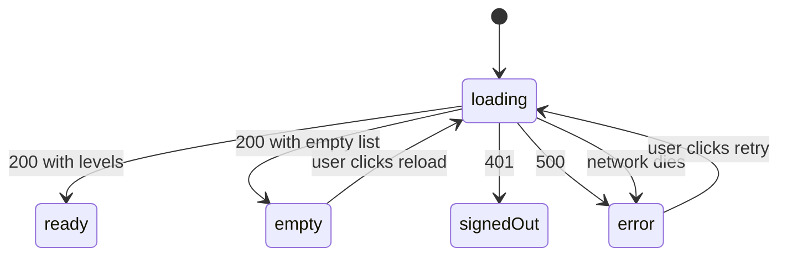

# Signed-in users can browse the level catalog

## Why

Players need to see the story levels and their coding challenges before they
submit code. The catalog is read-only content shared by every user.

## Where it lives

- `apps/web/app/api/levels/route.ts` — `GET /api/levels`
- `apps/web/app/api/levels/[levelId]/route.ts` — `GET /api/levels/:levelId`
- `packages/domain/src/schemas/level.ts` — `LevelIdParam` validation
- `packages/domain/src/queries/levels.ts` — `listLevels`, `getLevel`
- `apps/web/components/LevelList.tsx` — client component that renders the list
- `apps/web/app/page.tsx` — renders `LevelList` on the home page

## Behavior

- Both endpoints require a session. Signed out returns 401 `UNAUTHENTICATED`.
- No endpoint accepts `userId`. Levels are not user-scoped.
- `GET /api/levels` returns `{ levels }`, ordered by `order` ascending, with full rows.
- `GET /api/levels/:levelId` returns `{ level }`.
- A `levelId` that is empty after trimming returns 400 `VALIDATION`.
- An unknown `levelId` returns 404 `NOT_FOUND`, never 403.
- Unexpected failures (such as the database being down) return 500 `INTERNAL`
  with a generic message. Raw errors are never sent to the client.

## UI states

`LevelList` calls `GET /api/levels`. State is one variable, `status`:
`"loading" | "ready" | "signedOut" | "error"`. "Empty" is computed
(`ready` and `levels.length === 0`), not stored.

- `loading` shows a skeleton. `error` shows the API's message and a Retry button.
- `signedOut` shows a "Sign in again" link and no Retry, because a 401 does not fix itself.
- `empty` shows a message and a Reload button.

## Examples

| State / input                               | Behavior                             |
| ------------------------------------------- | ------------------------------------ |
| Signed in, `GET /api/levels`                | 200, `{ levels }` ordered by `order` |
| Signed out, `GET /api/levels`               | 401 `UNAUTHENTICATED`                |
| Signed in, `GET /api/levels/<existing id>`  | 200, `{ level }`                     |
| Signed in, `GET /api/levels/doesnotexist`   | 404 `NOT_FOUND`                      |
| Signed in, `GET /api/levels/%20` (blank id) | 400 `VALIDATION`                     |
| Database down, either endpoint              | 500 `INTERNAL`, generic message      |

## Verify

- `pnpm typecheck`
- `pnpm test:integration` (covers the domain queries)
- curl drill: signed out → 401; signed in → list and single level; unknown id → 404.
- UI drill: with `pnpm db:dev` and `pnpm dev:web` running, ride each arrow on the
  diagram: block or break the fetch (error, Retry), delete the `session` cookie
  (signedOut), stop the database (error), and return an empty list (empty, Reload).

## Constraints & decisions

- The list returns full rows, including story and challenge text. There is no
  pagination, because the catalog is small.
- A 401 gets its own `signedOut` stop, because Retry would loop forever.
- The home page still loads levels on the server for `ProgressForm`, and
  `LevelList` fetches them again in the browser.
- The home page's own "No levels" message shows before `LevelList` mounts, so
  `LevelList`'s empty state is only reachable there in a race.

## Out of scope

- Submissions: see [submissions.md](submissions.md).
- Progress and the current level: see the specs in `progress/`.
- Creating or editing levels: levels are seeded, and there is no write API.
