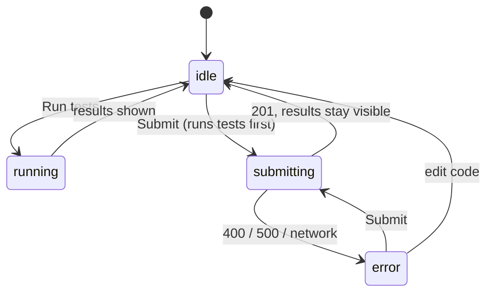

# A level with challenge tests grades the player's code in the browser

## Why

A player learns more when the game tells them whether their code works, not
only that it was saved. The first level gives a small function to write in a
real code editor, and unit tests show which inputs give the expected output.

## Where it lives

- `packages/db/prisma/migrations/0002_level_challenge.sql` — the
  `Level.starterCode` and `Level.challengeTests` columns
- `packages/domain/src/schemas/challenge.ts` — `ChallengeTests`, the Zod
  shape of a level's tests
- `packages/domain/src/challenge/run-tests.ts` — `runChallengeTests`, the
  pure grader
- `packages/domain/src/challenge/index.ts` — the `@project/domain/challenge`
  entry point, safe to import in the browser
- `apps/web/lib/challenge.worker.ts` — the Web Worker that runs the grader
- `apps/web/lib/run-in-worker.ts` — starts the worker and enforces the time limit
- `apps/web/components/CodeEditor.tsx` — the CodeMirror editor
- `apps/web/components/SubmissionForm.tsx` — editor, Run tests, submit
- `apps/web/components/TestResults.tsx` — the live-region summary and per-case results
- `apps/migrate/src/seed.ts` — level 1's story, starter code, and tests

## Behavior

- A level's `challengeTests` is either `null` or
  `{ functionName, cases: [{ args, expected }] }`, with 1–50 cases.
  `functionName` is a JavaScript identifier. `GET /api/levels` returns
  `starterCode` and `challengeTests` with the rest of the row.
- Every level's solution box is a CodeMirror editor with JavaScript
  highlighting. It starts with the level's `starterCode`, or empty when that
  is `null`. Tab moves focus out of the editor, so it is not a keyboard trap.
- Each level card displays a three-stage progress preview with stage 1 marked
  current and the later stages shown as locked. This is presentation only;
  stage completion and unlocking are not tracked or persisted.
- When a level has `challengeTests`, the form shows a **Run tests** button.
  Running the tests:
  1. evaluates the player's code in a fresh Web Worker, in strict mode;
  2. calls `functionName(...args)` once per case, in order;
  3. passes a case when the return value deeply equals `expected`
     (primitives use `Object.is`; arrays and plain objects are compared
     member by member);
  4. reports each case as passed, failed (with expected and actual values),
     or errored (with the thrown message).
- A syntax error, or code that never defines `functionName`, fails every case
  with one message that says what went wrong.
- A run that takes more than 2 seconds is stopped. Every case fails with a
  "took too long" message, so an infinite loop never freezes the page.
- **Submit solution** on a level with tests runs the tests first. It then
  posts the code with `isPassed: true` only when every case passed. On a
  level without tests, submit posts `isPassed: false`, as before.
- Results are announced to screen readers through a `role="status"` live
  region (`TestResults`) that is in the page from the first render and empty
  until a run starts. It says "Running tests…" when a run starts, then
  "N of M tests passed." Every run is announced, even when the result is the
  same as the last one, because "Running tests…" comes between. Editing the
  code clears the results without announcing anything.
- The per-case results follow the buttons in reading order. Each case is a
  list item that starts with "Passed:" or "Failed:" in text, not only a
  ✓/✗ icon.
- While tests run or a submission is in flight, Run tests and Submit are
  `aria-disabled`, not `disabled`, so focus stays on the button that was
  pressed. Submit outcomes and errors are announced through a second
  always-present `role="status"` region.
- When `challengeTests` does not match the `ChallengeTests` shape, the form
  says the tests could not be loaded and does not offer Run tests. Submitting
  still works and posts `isPassed: false`.
- After a test run, the form offers one optional local AI action. When tests
  are still failing it is **Small nudge**, which asks Ollama Mistral for one
  short conceptual question without code or step-by-step instructions. Once all challenge tests pass, it
  becomes **Explain this**, which breaks down why the submitted code is
  correct. The current challenge, code, and test results are sent only to the
  configured Ollama endpoint; no AI response is stored with the submission.
- If Ollama is not installed, running, or has the configured model, the
  existing challenge and submission flow still work and the UI shows a brief
  unavailable message.

## UI states

`SubmissionForm` has one `status` value. The results panel shows the latest
run until the code changes.



## Examples

Level 1 asks for `greet(name)` that returns `"Hello, <name>!"`.

| State / input | Behavior |
|---|---|
| `function greet(n) { return "Hello, " + n + "!"; }` | 3/3 pass; submit stores `isPassed: true` |
| `function greet(n) { return "Hi " + n; }` | 3/3 fail, each showing expected vs actual; `isPassed: false` |
| `function greet(n) { throw new Error("nope") }` | each case errors with `nope` |
| `function greet(n) {` (syntax error) | every case fails with the syntax error message |
| Code defines `hello`, not `greet` | every case fails: "`greet` is not defined as a function" |
| `function greet() { while (true) {} }` | stopped after 2 s; every case fails as "took too long" |
| Level 2 (no `challengeTests`) | editor only, no Run tests; submit stores `isPassed: false` |
| Expected `[1, 2]`, actual `[1, 2]` | passes (deep equality, not `===`) |

## Verify

- `pnpm test`: `packages/domain/tests/run-challenge-tests.test.ts` covers the
  grader and `challenge-schema.test.ts` covers the shape.
- `pnpm test:integration`: `tests/integration/levels.test.ts` stores a level
  with `challengeTests` and reads it back.
- `pnpm typecheck`, `pnpm build`.
- Browser drill (with `pnpm dev`, then `pnpm --filter @project/migrate seed`): on level 1, run the
  starter code (all fail), the correct solution (all pass), and
  `while(true){}` (stopped at 2 s, page stays responsive). Submit the
  passing solution and check that `GET /api/submissions` shows
  `isPassed: true`.
- Keyboard drill: Tab into the editor, type, then Tab out to Run tests.
  Press Enter: focus stays on Run tests while the tests run.
- Screen-reader drill (VoiceOver or NVDA): Run tests announces "Running
  tests…" then the summary; running again with the same code announces it
  again; reading forward from the buttons reaches each case.
- `pnpm test` also runs `apps/web/tests/test-results.test.tsx`, which finds
  the live region by role and checks it is the same element before and
  after a run.
- Optional AI drill: install Ollama, run `ollama pull mistral` and
  `ollama serve`, then open a challenge, run a failing solution and use
  **Small nudge**, then run a passing solution and use **Explain this**.
  Without Ollama, confirm the normal test and submit actions still work.

## Constraints & decisions

- Code runs in the player's browser, not on the server, and `isPassed` is
  self-reported by the client. See
  [ADR-0012](../../adr/0012-client-side-challenge-runner.md).
- Tests are data (JSON args and expected values), not code. So the server
  never stores or evaluates test code, and the grader can only compare JSON
  values. Challenges that need `undefined`, functions, or class instances as
  expected values are not supported.
- `@project/domain/challenge` is a separate entry point, because the main
  `@project/domain` index imports Prisma and cannot be bundled for the browser.
- The editor uses the official `codemirror` packages with a small wrapper,
  not a third-party React binding.
- The 2-second limit applies to the whole run, not to each case. The clock
  starts when the worker has loaded, so a slow first load in dev isn't
  counted against the player.
- A syntax error message comes from the engine compiling the wrapped code,
  so it can name a token past the player's last line (an unclosed `{`
  reports `Unexpected token ')'`). Showing a precise location would need a
  separate parser.

## Out of scope

- Server-side grading, or checking `isPassed` on the server: see the ADR.
- Moving the player to the next level after a pass: progress is set by hand
  (see [progress.md](../progress/progress.md)).
- Capturing `console.log` output, languages other than JavaScript, and tests
  or starter code for levels after level 1.
- Storing submissions: see [submissions.md](../submissions/submissions.md).
- Cloud-hosted model providers, automatic code changes, and AI help before a
  test run.

## Optional Ollama setup

The feature requires Ollama installed and running on the same machine as the
web app, the `mistral` model downloaded, and enough local memory for that
model. A practical minimum is 8 GB RAM and about 4 GB of free disk space;
more memory improves responsiveness. No API key or cloud account is needed.

```bash
ollama pull mistral
ollama serve
```

The web app defaults to `http://127.0.0.1:11434` and `mistral`. Set
`OLLAMA_BASE_URL` or `OLLAMA_MODEL` in the environment when using a different
local endpoint or model. The feature is optional: the rest of the challenge
works normally when Ollama is unavailable.
