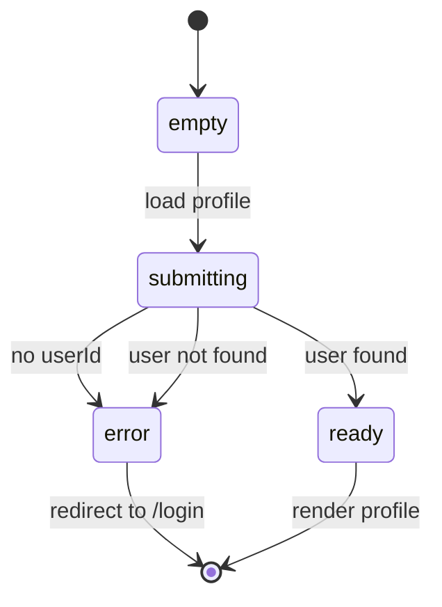

# type: profile

# Why
Users that are signed in will be able to view their profile, showing their credentials such as their name, emails and current level. 

# Where it lives 
- apps/web/components/profile.tsx
- apps/web/app/profile/page.tsx
- packages/domain/src/queries/identities.ts
- apps/web/app/api/auth/login/route.ts

# Behaviour
The profile button renders a user's profile information when requested. It starts as an empty state. Once the button is pressed. It submits a GET request to api/identities/me. 

If the response comes back as error due to no user id or user not found, it redirects the request to api/auth/login. 
If user is found, a 201 is returned and the user profile is rendered

# Example
| State           |   Behaviour/Results |
|---|---|
|Not signed in | A 401 is returned and redirected to the user sign in page|
|Wrong user id | A 401 is returned and redirected to the user sign in page
|Signed in user | A 201 is returned and page rendered|
